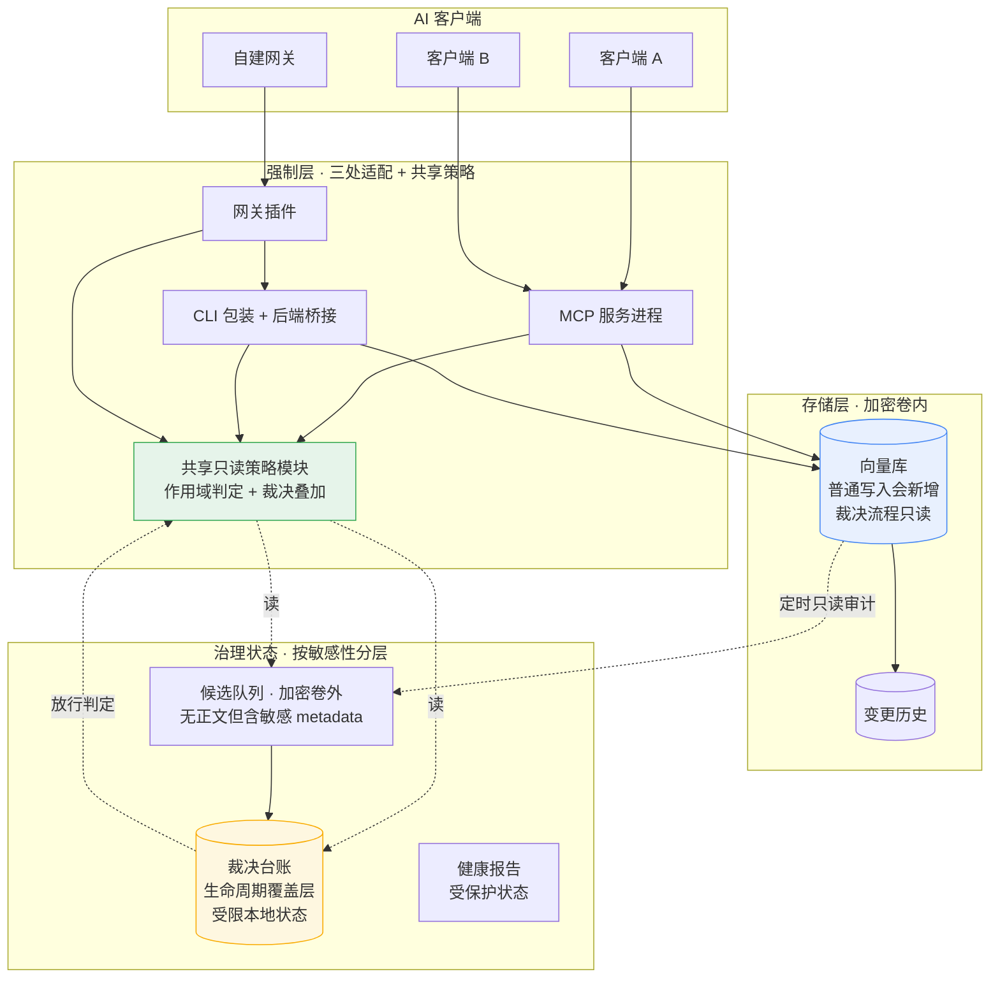
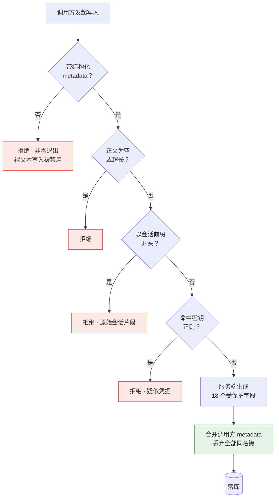
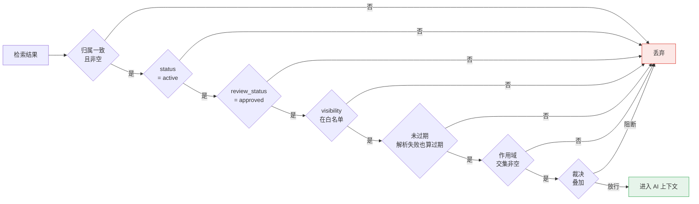
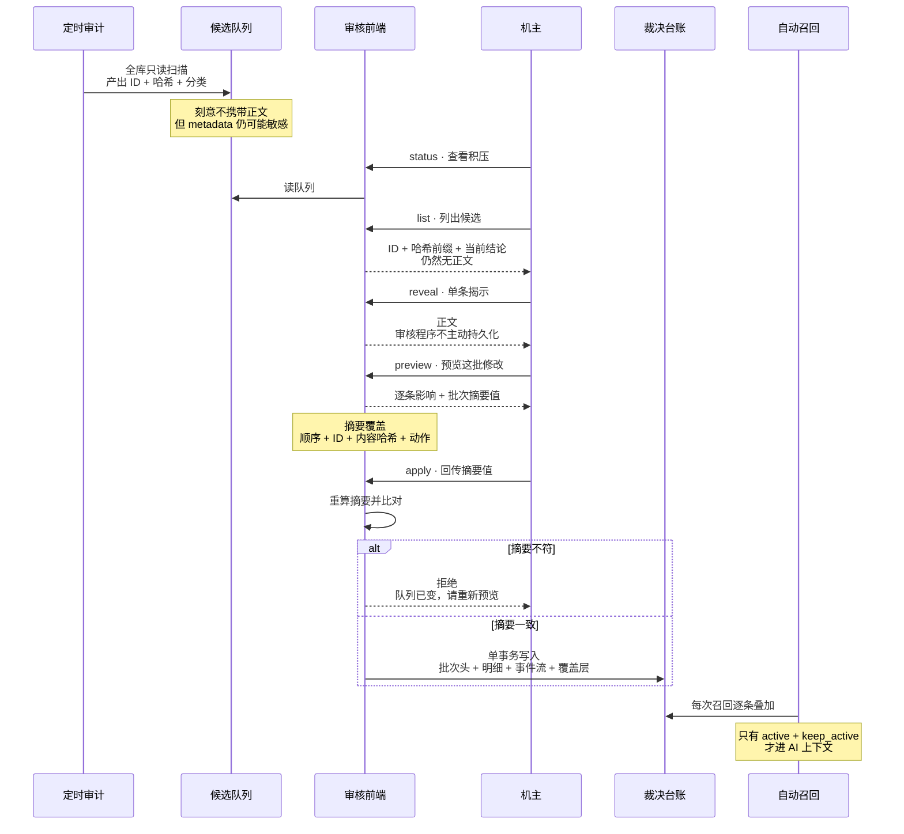
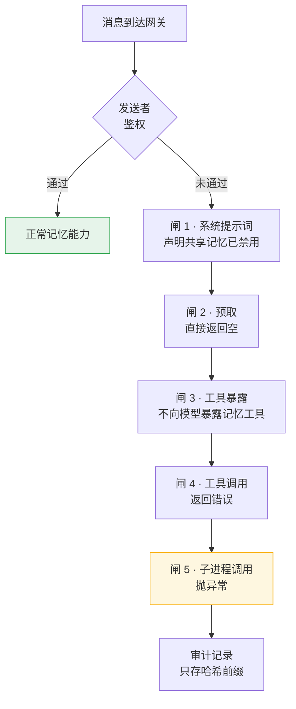
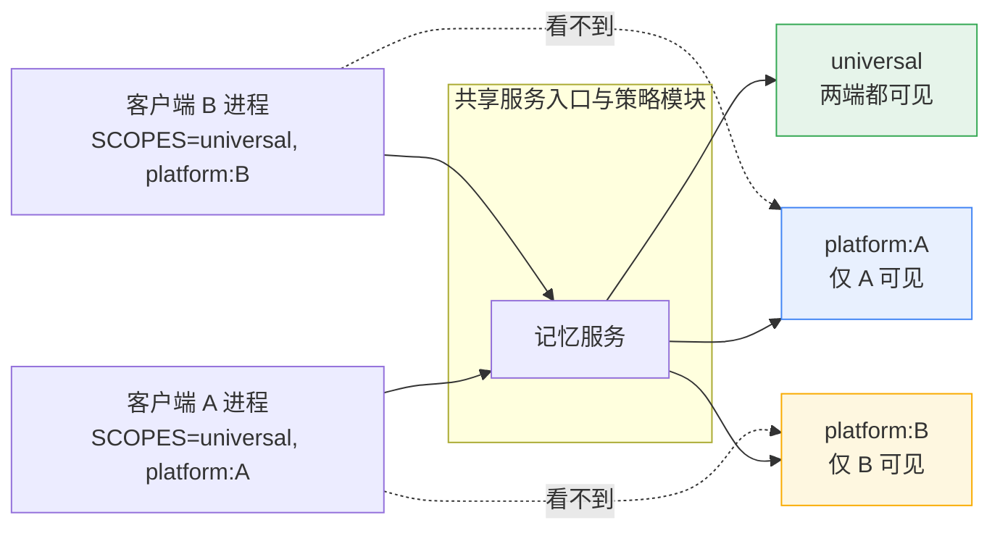

# 架构图

以下 Mermaid 图是对当前案例的简化表达，不是完整数据流或操作系统安全边界；参考建议会在正文中单独标明。GitHub 可原生渲染这些代码块。

---

## 一、整体分层

要点：三个接入适配仍各自承担一部分基础过滤，共享只读策略模块负责 scope 与裁决叠加。向量库在加密卷内；普通持久记忆路径会新增记录，裁决流程只读原记录并把结论写入独立台账。候选队列虽然不含正文，但其中的 ID、哈希、关系和理由仍需按敏感 metadata 保护。

---

## 二、写入契约

关键在 `MERGE` 那一步：当前适配器保留服务端值，并忽略调用方提交的受保护同名键。静默忽略不普遍强于显式拒绝；采用者可以选择拒绝以提高误用可见性，但不能接受调用方值作为权威值。

---

## 三、召回过滤链

三个容易写错的地方：归属为空要判不通过；有效期解析失败要判不通过；作用域非法要报错而不是当成通用。

---

## 四、人工裁决链路

摘要校验用于检测预览载荷与提交载荷是否一致；应用阶段还要重验当前队列与内容哈希。它不证明用户看过、理解或授权了这批操作。

---

## 五、身份鉴权五道闸

五道闸防的是不同的失效方式，靠近底层的检查用于降低新增调用路径漏加入口校验的风险。它们仍是应用层纵深防御，不能阻止同一账户下的恶意进程直接读库。

---

## 六、作用域隔离

环境变量表达运行时治理范围，它是应用层策略，不是操作系统安全隔离。共享策略模块降低了漂移，但三处基础过滤适配仍可能不一致；完整性比对主要发现无意配置漂移，不能抵抗能恶意修改本机配置的人。

---

回到 [中文首页](../README.zh-CN.md)
